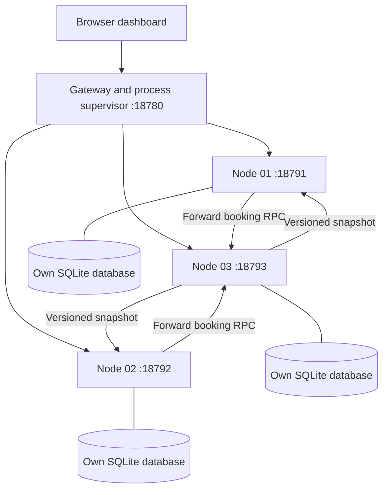

# SeatSync

A distributed ticket booking laboratory that runs entirely on one laptop. Three independent Python server processes communicate through HTTP/JSON RPC and keep separate SQLite databases. A browser dashboard makes coordination, replica state, elections, and failure experiments visible.

## Run locally

Requires **Python 3.10 or newer**. No pip packages, Node.js, Docker, cloud services, or internet connection are needed to run the application.

On Windows, double-click **Start SeatSync.cmd**, or run:

```powershell
python app.py
```

Open **http://127.0.0.1:18780** after the terminal says SeatSync is ready. Keep the terminal open during the demonstration. Press **Ctrl+C** to stop the dashboard and its child server processes. Bookings persist across restarts.

If the dashboard port is occupied:

```powershell
python app.py --port 18781
```

To change the three node ports on Windows:

```powershell
$env:TICKET_NODE_BASE = '18990'
python app.py
```

Nodes then use ports 18991, 18992, and 18993. Use a different base for concurrently running copies, and use a different `--data` directory too.

## Demonstrate it in five minutes

1. Select a seat, enter a guest name, choose Node 01, and reserve. Node 01 forwards to the elected coordinator, initially Node 03. Check that all three replicas show the booking.
2. Select a different available seat and click **Run race**. Twelve clients submit at a barrier through the online entry nodes. Expect **one confirmation and eleven conflicts**, with zero errors on a stable cluster.
3. Click **Test failover** with all three nodes online. The supervisor kills the actual leader process. Surviving nodes detect its missing heartbeat and run Bully election. Node 02 normally takes over. Existing reservations remain visible.
4. Book another seat through a surviving entry node to demonstrate continued service.
5. Click **Restart** for Node 03. It reads its database, recovers the latest snapshot from peers, and regains leadership as the highest ID. All replicas converge.
6. Optional: stop two followers. A single remaining node refuses new reservations because it cannot obtain two durable copies. Restart them to recover service.
7. Click **Export evidence** to download the current metrics, bookings, node states, event history, and experiment results as JSON.

**Reset demo data** opens a confirmation dialog. It removes only this demo's three SQLite databases and restarts the cluster. Use it to start a clean demonstration.

## Course concepts

| Course topic | Concrete implementation |
| --- | --- |
| Client–server architecture and clusters | Browser, gateway, and three independently running replicas |
| RPC and communication failures | JSON requests over loopback HTTP, timeouts, application errors, and retry IDs |
| Centralized distributed mutual exclusion | Entry nodes forward to an elected coordinator whose mutex serializes booking critical sections |
| Bully election | Nodes challenge higher IDs, await their coordinator announcement, and let the highest reachable ID recover before promotion |
| Failure detection | Followers probe their coordinator every 750 ms with a bounded RPC timeout |
| Replication and process resilience | Separate SQLite databases, versioned full-state snapshots, quorum acknowledgement, and recovery before promotion |
| Lamport logical clocks | Local events and outgoing mutating RPCs increment counters, and incoming mutating RPCs apply max(local, received) + 1 |
| Names and addresses | Stable logical IDs Node 01–03 map to configurable loopback addresses in the fixed membership configuration |

Naming here is a small static mapping, not a DNS implementation. Physical clock synchronization, vector clocks, token rings, RMI, and atomic multicast are outside the implemented scope.

## Architecture



The gateway handles browser requests and process controls. It does **not** choose the leader, grant booking locks, or store authoritative reservations. Nodes perform those operations themselves. The diagram shows the initial coordinator. After an election, forwarding and replication follow the new coordinator.

## Booking protocol

1. An entry node validates the request and forwards it to its known coordinator.
2. The coordinator takes its process-local mutex. Because every booking node uses that coordinator, this provides centralized mutual exclusion across the cluster.
3. It checks the idempotency key, seat ownership, higher-priority node availability, and whether a second replica is reachable.
4. It creates a versioned snapshot and commits its own SQLite transaction with synchronous writes.
5. It sends that snapshot to reachable replicas. A success response requires acknowledgement from at least **two of three** nodes, including the coordinator.
6. It releases the mutex. Every acknowledged booking has one durable booking ID for its seat.

Full snapshots are intentionally simple for a 48-seat demonstration. This approach is inefficient for large inventories. The 55 ms pause inside a new booking's critical section is an intentional teaching aid, not a performance optimization.

## Recovery and assumptions

This is an educational **fixed-membership local crash/recovery system**. Its supported demonstration assumes a reliable loopback network, bounded local scheduling, trustworthy nodes, and process crashes. Higher IDs have higher election priority. Before promotion, a candidate reads reachable replicas, keeps the snapshot with the greatest `(term, sequence)` version, advances the term, and replicates it to a quorum.

The protocol is **not Raft or Paxos** and does not establish consensus or prevent split brain under arbitrary network partitions, asymmetric reachability, or prolonged scheduling pauses. Bully election alone cannot provide those guarantees. A production system would need a consensus protocol, fencing, authentication, and more rigorous recovery rules.

If a coordinator crashes after recording or replicating a reservation but before replying, the client may not know whether it succeeded. Recovery can retain that reservation. Retry **with the same request ID**, seat, and guest name through a live node. Reusing the ID with different data is rejected. Even duplicate confirmations require a quorum. The application does not claim exactly-once delivery or all-or-nothing distributed commits.

The dashboard reads the highest observed snapshot for display. During recovery this can include an outcome whose client acknowledgement is uncertain. Event rows use wall-clock time for a convenient same-laptop timeline. Lamport values demonstrate logical event order and do not measure elapsed milliseconds. GET heartbeat/status RPCs are outside the logical-clock tracing example.

## Test and evaluate

```powershell
python tests/test_cluster.py
```

The integration suite starts real node subprocesses on isolated ports **18891–18893** with temporary databases. It covers election, a twelve-request race, identical replica contents, idempotency, invalid inputs, leader crash, booking with one node offline, higher and lower ID recovery, quorum loss, and durability across a full cluster restart.

Measured results from the completed run are in [docs/test-results.json](docs/test-results.json). They describe one local experiment, not a general benchmark. The suite rewrites this file when rerun.

Dashboard metrics are process-lifetime values for **currently online processes**. They reset when a node restarts, and the aggregate may drop when a node stops. RPC counts include monitoring traffic. Critical-section latency covers successful new-booking work after lock acquisition, including durable replication, and excludes the wait to acquire the lock. The race report separately measures end-to-end request latency. Failover time includes the supervisor's detection polling.

## Files

- `app.py`: gateway, process supervisor, experiments, and evidence API.
- `node.py`: election, coordinator mutex, RPC handlers, durable replication, and recovery.
- `common.py`: shared wire protocol, node addresses, and seat inventory.
- `web/`: offline browser interface.
- `tests/test_cluster.py`: integration tests using real subprocesses and TCP.
- `docs/`: presentation, demo script, design explanation, screenshots, and measured results.
- `.runtime/`: ignored local databases and process logs.

All services bind to **127.0.0.1**. This local demo has no payment processing, user accounts, cancellation workflow, or public hosting. No real payments occur.

For a startup problem, check the terminal and `.runtime/node-1.log` through `node-3.log`. If you forcibly closed the launcher and left node processes running, close those specific Python processes before restarting, or choose another base port and data directory.
